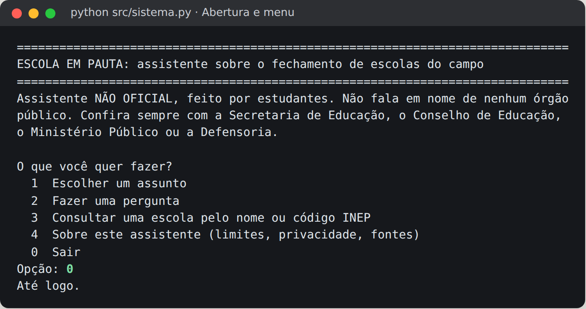
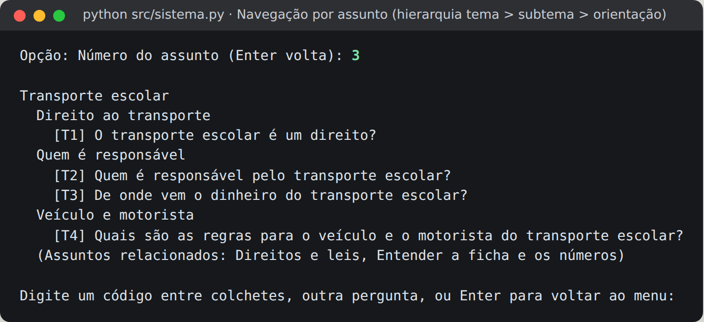
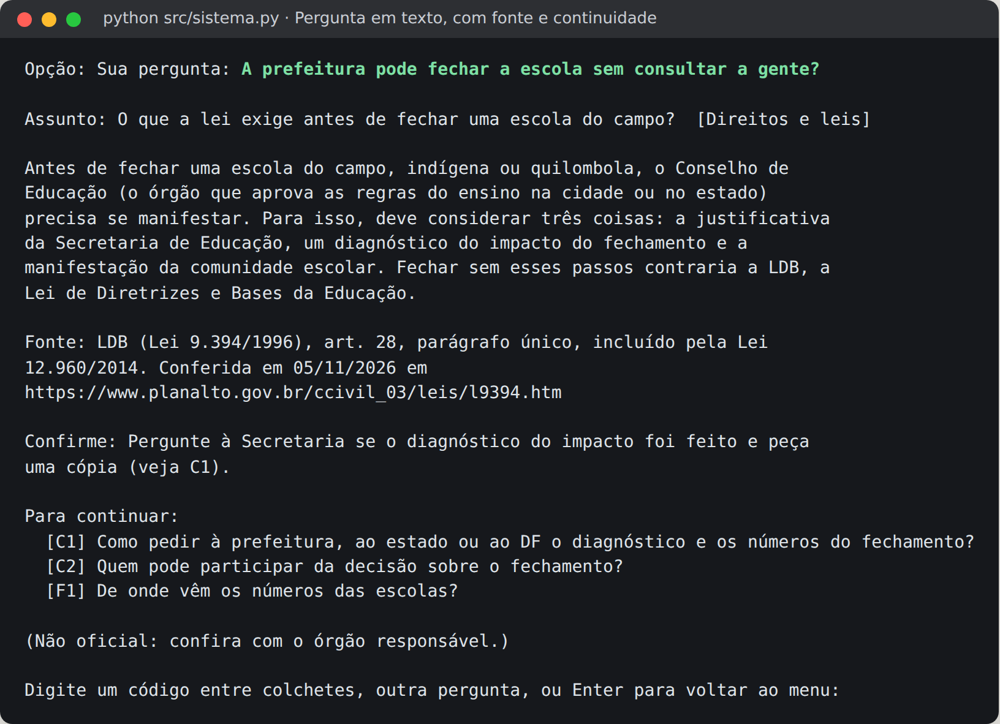
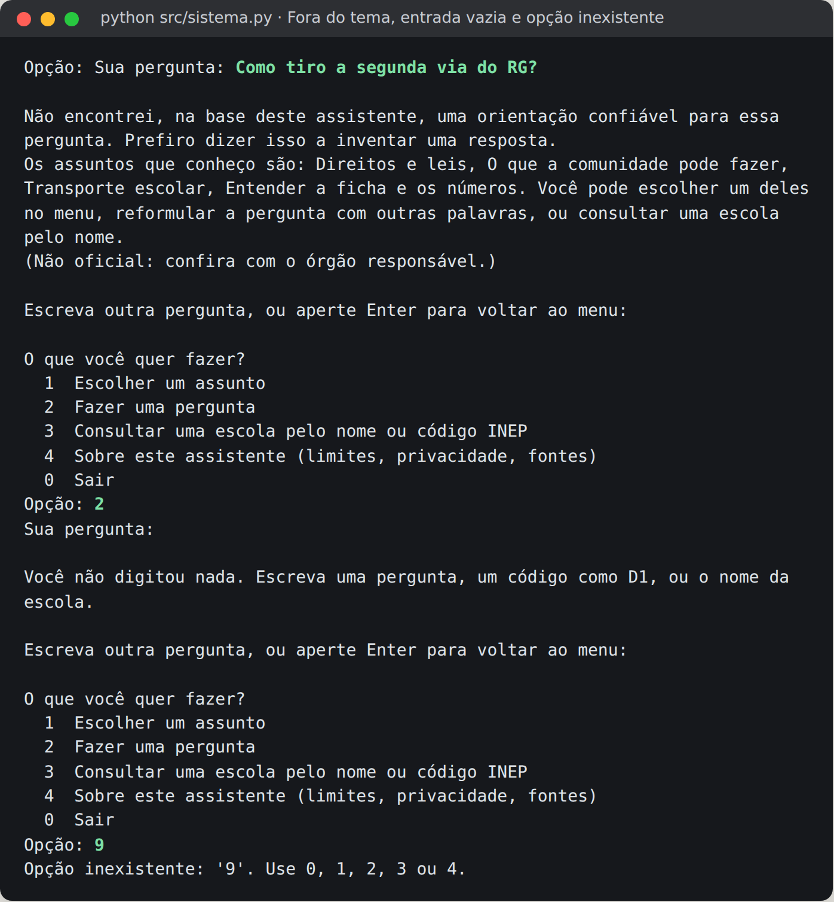
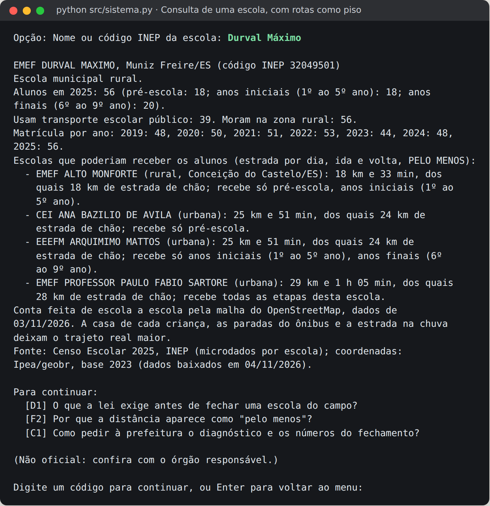
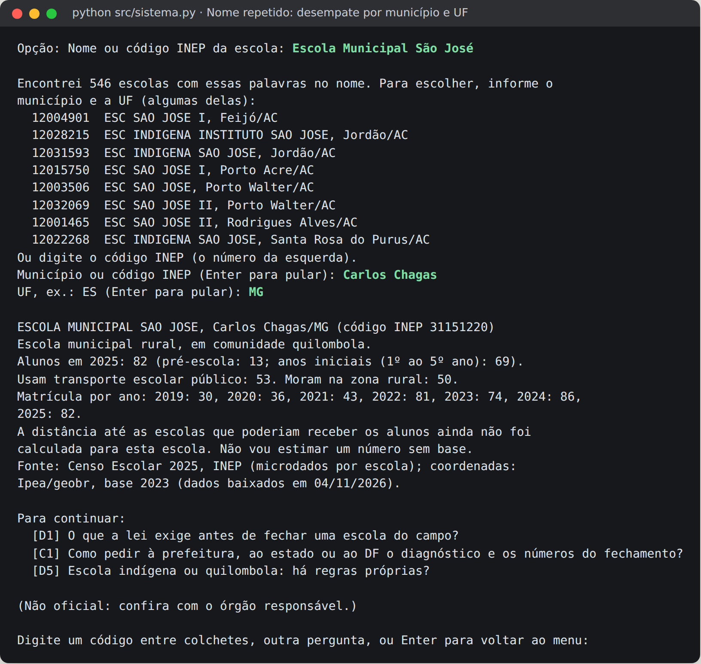

# FIAP - Faculdade de Informática e Administração Paulista

<p align="center">
<a href="https://www.fiap.com.br/">
  
</a>
</p>

<br>

# Escola em Pauta: assistente sobre o fechamento de escolas do campo

Global Solution 2026, 2º semestre. Desafio CitizenTech, case Citizen Assist AI.

> **TL;DR**
>
> - **O problema.** Antes de fechar uma escola do campo, a LDB exige um diagnóstico do impacto e a manifestação da comunidade. A comunidade chega à reunião sem saber os direitos e sem os números. De 2019 a 2025, 19.159 escolas públicas rurais foram extintas.
> - **A solução.** Um assistente que responde em linguagem simples com 27 orientações conferidas no texto oficial, sempre com fonte e data, e que diz "não sei" quando a base não cobre a pergunta. Junto, a ficha de cada uma das **53.759 escolas do campo**: alunos por etapa, transporte, série da matrícula e quanta estrada separa a escola das que receberiam os alunos.
> - **Como funciona.** Regras explícitas e índice invertido, sem modelo de linguagem gerando resposta. Rotas pela malha do OpenStreetMap, com Dijkstra e velocidade de ônibus escolar, pré-calculadas para 36.112 escolas. O terminal usa só a biblioteca padrão do Python; a versão web é o mesmo núcleo em TypeScript, preso ao terminal por um contrato de 130 perguntas.
> - **O que os números mostram.** Se a escola fechar, a mediana é de pelo menos 12,7 km por dia até a escola mais próxima que recebe todas as etapas. No Centro-Oeste, 1 em cada 3 escolas fica a 50 km ou mais. 930 escolas (114 mil alunos) passariam a 2 horas ou mais de ônibus por dia. Na EMEF Durval Máximo (ES), o cálculo dá 25 km por dia, coerente como piso com os "até 52 km" estimados pelo Tribunal de Contas.
> - **A medida honesta.** Em 50 perguntas escritas às cegas, antes de qualquer ajuste, o assistente acertou 68%. Numa rodada nova, com 60 perguntas, 52%, e o erro foi quase todo "não sei" (20 casos contra 3 respostas erradas sem aviso). Os usuários dos testes foram simulados, e isso está declarado.
> - **Para usar.** `python src/sistema.py` (Python 3.10 ou mais recente, sem instalar nada, sem internet) ou a **[versão web](https://iurileao-hub.github.io/global-solution-citizentech/)** no celular, que funciona sem sinal depois da primeira visita.

## Grupo 9

## 👨‍🎓 Integrantes

| Nome | RM |
|---|---|
| Gabriel Carmona Bittencourt | RM569239 |
| Gabrielly Drosda da Silva | RM571793 |
| Iúri Leão de Almeida | RM570215 |
| Márcio Francisco dos Santos Júnior | RM570758 |
| Maria Sophia Domingues dos Santos | RM571209 |

## 👩‍🏫 Professores

### Tutor
- André Tritiack

### Coordenador
- <a href="https://www.linkedin.com/in/andregodoichiovato/">André Godoi Chiovato</a>

## 📜 Descrição

O **Assistente Escola em Pauta** responde, em linguagem simples, as perguntas de pais, comunidade escolar e conselheiros quando uma prefeitura ou um estado anuncia o fechamento de uma escola do campo: o que a lei exige, como pedir os números, a quem recorrer, quem responde pelo transporte e pela merenda. Cada resposta vem de uma base de orientações conferidas no texto oficial, com a fonte e a data da conferência. Quando a pergunta não está na base, o assistente diz isso e sugere outro caminho.

O assistente também consulta qualquer uma das **53.759 escolas do campo** do Censo Escolar 2025: quantas crianças estudam ali, por etapa, quantas usam transporte, como a matrícula variou de 2019 a 2025 e, quando já calculado, quanta estrada separa a escola das que poderiam receber os alunos, sempre como **piso** ("pelo menos").

```bash
python src/sistema.py
```

Só a biblioteca padrão do Python (3.10 ou mais recente). Funciona sem internet e não pede nenhum dado pessoal.

<p align="center"></p>

### 1. O problema, quem ele atinge e os temas abordados

A LDB (art. 28, parágrafo único, incluído pela Lei 12.960/2014) exige que o fechamento de escolas do campo, indígenas e quilombolas seja precedido de manifestação do Conselho de Educação, que deve considerar a justificativa da Secretaria, um **diagnóstico do impacto** e a **manifestação da comunidade escolar**. A lei não define como esse diagnóstico deve ser feito, e um projeto de lei para padronizá-lo (PL 3.091/2024) está parado na Câmara desde maio de 2026. Na prática, a comunidade costuma ser chamada a se manifestar sem saber quais são os seus direitos, sem os números e sem saber a quem pedir. Os números só aparecem depois, no recurso ao Ministério Público ou na auditoria do Tribunal de Contas.

**Público beneficiado:** famílias e comunidade escolar de escolas do campo, indígenas e quilombolas; conselheiros municipais e escolares; quem as apoia (associações, sindicatos rurais, Defensoria); e o gestor da Secretaria que precisa cumprir o rito antes de propor um fechamento.

**Temas (4) e orientações (27):**

| Tema | Subtemas | Exemplos de pergunta |
|---|---|---|
| Direitos e leis | fechamento, escola do campo, criança, povos indígenas e quilombolas, alimentação | "A prefeitura pode fechar sem consultar a gente?" |
| O que a comunidade pode fazer | pedir informação, participar, recorrer, casos reais | "Como consigo os números da prefeitura?" |
| Transporte escolar | direito, responsáveis, veículo e motorista | "Quem paga o ônibus escolar?" |
| Entender a ficha e os números | fontes, como ler, quantas escolas fecharam por estado e município | "Quantas escolas do campo já fecharam aqui em Minas?" |

O problema foi escolhido por um processo explícito, antes de qualquer decisão de tecnologia: ver [`docs/metodologia.md`](docs/metodologia.md).

### 2. Base de conhecimento, estruturas de dados e estratégia de busca

**Arquivos (em `data/`):**

| Arquivo | Conteúdo |
|---|---|
| `base_orientacoes.json` | 27 orientações, 4 temas. Cada registro tem `id`, `tema`, `subtema`, `pergunta`, `palavras_chave` (com sinônimos populares: "roça", "van", "merenda"), `orientacao`, `referencia` (título e URL oficial), `data_verificacao`, `confirmar` (o que a pessoa deve confirmar) e `relacionados` |
| `escolas_campo.json.gz` | Índice nacional de escolas do campo (2,6 MB comprimido), gerado do Censo 2025 por `scripts/gerar_indice_escolas.py` |
| `perguntas_teste.json` | 20 perguntas de teste com a resposta esperada |
| `perguntas_cegas.json` | 50 perguntas escritas às cegas por personas simuladas, com o rótulo do juiz |
| `perguntas_r3.json` | 60 perguntas da terceira rodada (seis personas novas), com o rótulo de um juiz novo |
| `fechamentos.json` | Escolas públicas rurais ativas, paralisadas e extintas de 2019 a 2025, por UF e município (Censo), gerado por `scripts/gerar_fechamentos.py` |
| `retrato_rotas.json` | O retrato nacional das rotas por Brasil, região, UF e localização diferenciada (seção 8), gerado por `scripts/gerar_retrato_rotas.py` |
| `regressao_web.json` | O contrato entre o terminal e a versão web: as respostas do Python às 130 perguntas rotuladas e a 12 buscas de escola (ver Decisões Técnicas) |
| `resultados_*.csv`, `indicadores*.json` | O registro de cada rodada de avaliação (seção 4): esperado, obtido, classificação e tempo |

**Origem das orientações.** Cada norma foi lida no texto oficial (Planalto, MEC/CNE, Senado, Câmara, FNDE, INEP, Prefeitura de Santa Cruz do Sul, Ministério Público de Contas do ES) em 05/11/2026. A conferência registrou correções que mudaram o texto da base: o mínimo de compra da agricultura familiar no PNAE subiu para **45%** em 2026 (a página do FNDE ainda diz 30%); a nucleação dos anos iniciais é permitida em caráter excepcional, dentro do campo; e "paralisada", no Censo, significa atividades **temporariamente suspensas**, sem extinção formal.

**Acrescentar ou corrigir uma orientação** é editar o JSON. O programa não muda: a validação confere campos obrigatórios, ids repetidos, temas e relacionados que não existem, URL e formato da data, e diz qual registro e qual campo estão errados. Arquivo ausente, vazio ou com JSON inválido gera uma mensagem compreensível e o programa não abre com dado torto.

**Estruturas de dados:**

- **Dicionário por identificador** (`registros[id]`, `por_codigo[codigo_inep]`): busca direta por código.
- **Hierarquia tema → subtema → orientação**, usada no menu "Escolher um assunto".
- **Grafo de assuntos:** cada orientação aponta para outras em `relacionados` (por exemplo D1 → C1, C2, F1; T1 → T2, T3, T4), e cada tema aponta para temas vizinhos. É o que alimenta "Para continuar", a navegação entre assuntos. Uma escola quilombola ou indígena liga, pela base (`ligacoes_escola`), à orientação sobre povos e comunidades tradicionais.
- **Índice invertido** (termo → registros onde ele aparece), como o índice remissivo de um livro.

**Estratégia de busca (orientações).** O texto digitado é normalizado (minúsculas, sem acento, sem palavras vazias, sem números) e cortado no **radical** de 5 letras ("fechamento", "fecharam" e "fechar" viram "fecha"). Cada orientação pontua pela soma dos pesos dos termos que casam: palavra-chave 3, pergunta modelo 2, subtema 1, mais 1 ponto por palavra que casa **inteira**. Termos presentes em mais da metade dos registros ("escola") são ignorados, e o nome do lugar citado ("no Piauí") também, porque diz onde e não o assunto. O título da norma citada entra no índice com peso 1, para que "Resolução CNE/CEB 2/2008" chegue à orientação que a usa. Antes do radical, "x" vira "ch" dos dois lados, porque o reconhecimento de voz escreve "fexar", e siglas ditas letra a letra ("elê dê bê") viram a sigla. Uma orientação só responde se casar ao menos 34% dos termos da pergunta. Entre 34% e 60%, ela responde e avisa quais palavras da pergunta ficaram sem cobertura.

**Várias correspondências.** Ordena-se por pontuação, depois por número de termos casados, depois pela ordem da base. Se duas ou mais empatam no topo e são do **mesmo subtema** (elas se completam, como "quem é responsável" e "de onde vem o dinheiro" do transporte), o assistente responde a primeira e sugere a outra. Se são de **subtemas diferentes**, mostra as opções e pede para escolher. Abaixo do limiar, responde que não há base suficiente.

**Busca de escolas.** O nome é comparado por palavra inteira (nome próprio não usa radical), sem as palavras genéricas ("escola", "municipal", "EMEF"). O índice invertido devolve a **interseção** dos conjuntos de cada palavra. Quando todas as palavras do texto estão no nome de alguma escola, o assistente entende que a pessoa está nomeando uma escola. Nome repetido é a ambiguidade real do problema: há 546 escolas do campo com "São José" no nome, e o desempate é por município e UF.

<p align="center"></p>

### 3. Regras de resposta, modelos de instrução e tratamento das limitações

As respostas nunca saem da base: o texto da orientação é o do registro, palavra por palavra. A ordem das regras, em `src/assistente/nucleo.py`, é: entrada vazia → código digitado (D1, C5, ou falado: "ce um") → número solto, que não é código de escola → nome de escola → números de fechamento, quando a pergunta pede contagem ou cita um lugar ("quantas escolas fecharam no Piauí?") → busca nas orientações → "sem base suficiente". A primeira regra que se aplica decide.

**Dois modelos de instrução de resposta**, escritos como especificação (papel, formato, regras) em `src/assistente/respostas.py` e cumpridos por código:

| | Modelo A, "Direto" | Modelo B, "Orientador com limites" |
|---|---|---|
| Papel | responder com a orientação da base | assistente não oficial que orienta a comunidade, em linguagem simples, sem se passar por órgão público |
| Formato | orientação + fonte + rodapé | assunto entendido (para a pessoa conferir) + orientação + fonte e data + o que confirmar + até 3 caminhos para continuar + rodapé |
| Regras | só o texto da base; sempre citar a fonte | as de A, mais: dizer o que precisa ser confirmado, oferecer continuidade, nunca prometer atendimento oficial |

Comparação nas 20 perguntas de teste (`python src/sistema.py --avaliar`):

| Critério verificável | Modelo A | Modelo B |
|---|---|---|
| Cita a fonte e a data (respostas com orientação ou escola) | 15 de 15 | 15 de 15 |
| Diz o que confirmar, quando a orientação pede | 0 de 9 | 9 de 9 |
| Oferece caminho para continuar | 0 de 20 | 16 de 20 |
| Linhas por resposta (média) | 8,7 | 16,9 |
| Palavras por frase (média) | 17,4 | 15,1 |

**Escolhemos o modelo B como padrão.** O modelo A é mais curto, mas deixa de dizer o que a pessoa precisa confirmar justamente nas orientações em que isso importa (prazo de projeto de lei, regra municipal, merenda em área quilombola) e não oferece o passo seguinte. O custo do B é o tamanho, o dobro de linhas. O teste de facilidade de uso (seção 4) é o que vai dizer se esse tamanho atrapalha. Para usar o A: `python src/sistema.py --modelo A`.

**Limitações tratadas:** entrada vazia; texto só com palavras vazias; número solto ou opção de menu inexistente; pergunta fora do tema; consulta ambígua (orientações empatadas ou nome de escola repetido); escola sem coordenada pública ou sem rota calculada, em que o assistente diz que não vai estimar um número sem base. No Amazonas, no Pará e no Amapá, onde muitas escolas não se ligam por estrada às demais, o aviso diz que o transporte pode ser fluvial.

<p align="center"></p>

### 4. Testes, indicadores e interpretação

**Plano.** 20 perguntas de teste fictícias, escritas como uma pessoa da comunidade escreveria: 8 diretas, 4 reformulações, 2 fora do tema, 4 situações-limite (entrada vazia, nome de escola repetido, só palavras comuns, pergunta sem resposta confiável), 1 consulta de escola e 1 código digitado. Cada uma tem a resposta esperada (um ou mais ids aceitos, ou o comportamento esperado). O registro completo, com esperado, obtido, classificação e tempo, está em `data/resultados_testes_modelo_A.csv` e `..._B.csv`.

**Indicadores** (mediana de 30 repetições por pergunta):

| Indicador | Modelo A | Modelo B |
|---|---|---|
| Taxa de acerto (1ª rodada) | 75% | 75% |
| Taxa de acerto (após ajustes) | 100% | 100% |
| Tempo médio de consulta | 0,18 ms | 0,19 ms |
| Tempo máximo | 0,75 ms | 0,75 ms |

**Busca de escolas: linear × índice invertido** (mesmas consultas, mesmos resultados conferidos):

| Consulta | Escolas achadas | Busca linear | Índice invertido |
|---|---|---|---|
| Durval Máximo | 1 | 158 ms | 0,006 ms |
| Escola Municipal São José | 546 | 159 ms | 0,61 ms |
| Santo Antônio | 396 | 159 ms | 0,33 ms |
| Quilombo | 10 | 160 ms | 0,008 ms |

**Interpretação.** A primeira rodada errou 5 das 20 perguntas, e cada erro mostrou um problema típico de busca:

1. **Radicais que colidem.** "quilombola" e "quilômetros" viram ambos "quilo", e "particular" e "participar" viram "parti". A correção foi o bônus para palavra inteira.
2. **Uma palavra solta decidindo.** "Qual a melhor escola particular da cidade?" casava só "cidade" e respondia sobre escola na cidade. A correção foi a cobertura mínima de 40%.
3. **Nome de escola lido como pergunta.** "Escola Municipal São José" casava "municipal" com Conselho Municipal. A correção foi a prioridade para nome de escola.
4. **Empate legítimo tratado como ambiguidade**, resolvido pela regra do mesmo subtema.

O uso interativo achou mais quatro defeitos que a avaliação automática não pegava. O pior foi "são" descartado como verbo dentro de "São José", que fazia a busca devolver escolas sem "São" no nome.

O índice invertido responde de 260 a 26 mil vezes mais rápido que a busca linear, porque só toca as escolas que têm as palavras digitadas. A busca linear compara o nome de todas as 53.759 escolas a cada consulta.

**Limitações da avaliação.** Os 100% foram obtidos ajustando as regras nas mesmas 20 perguntas que os medem, o que superestima o acerto. Por isso a avaliação inclui um **segundo conjunto, escrito às cegas** (abaixo). Os tempos foram medidos numa única máquina (servidor ARM, 2 núcleos).

**Segundo conjunto: 50 perguntas escritas às cegas, e teste de facilidade de uso simulado.** Cinco agentes de IA, cada um no papel de uma pessoa que enfrenta o fechamento de uma escola (agricultora assentada com pouca escolaridade, liderança quilombola, conselheira municipal, professora rural, estudante ribeirinho), escreveram 10 perguntas cada **antes de ver o programa** e depois cumpriram 5 tarefas num terminal real, seguindo o roteiro de [`docs/teste_usabilidade.md`](docs/teste_usabilidade.md). Um juiz separado, que leu a base mas não viu as respostas, definiu a resposta esperada. **Os usuários foram simulados**; o desenho completo e os limites estão em [`docs/metodologia.md`](docs/metodologia.md).

| Nas 50 perguntas às cegas | Antes dos ajustes | Depois dos ajustes |
|---|---|---|
| Taxa de acerto | 68% | 88% |
| Erros calados (resposta errada sem aviso) | 16 | 3 |

Os 68% são o número honesto. O filtro de cobertura criado nos testes da equipe tinha ficado rigoroso demais para perguntas longas e naturais, e o assistente dizia "não sei" quando a base tinha a resposta. A correção principal foi a resposta parcial, que avisa quais palavras da pergunta a orientação não cobre. Os 88% já são otimistas, porque os ajustes foram feitos olhando essas perguntas.

| Tarefa (5 personas) | Concluíram |
|---|---|
| Descobrir o que a lei exige antes de fechar | 5 |
| Encontrar a EMEF Durval Máximo e dizer quantos alunos tem | 5 (todas leram 56) |
| Encontrar a Escola Municipal São José de Carlos Chagas (MG) | 5, três delas só na 2ª tentativa |
| Descobrir como pedir os números à prefeitura | 5 |
| Fazer uma pergunta fora da base e ver o que o assistente faz | 3 completas, 2 parciais |

Notas médias de 1 a 5: facilidade 3,8; entendimento 3,4; confiança 4,0. A nota de entendimento foi a mais baixa por causa do vocabulário jurídico ("órgão normativo", "nucleação", "LDB" sem explicação), que foi reescrito. A tarefa da São José falhava porque três das cinco personas escreveram o nome junto com a cidade, e o assistente passou a separar os dois.

Em seguida entraram cinco orientações novas, pedidas pelas próprias personas: barco escolar, o que o Conselho deve exigir, aluno com deficiência no transporte, adolescente pedindo informação e quantas escolas fecharam por lugar. Cada orientação nova pode tornar velho o rótulo de uma pergunta antiga, porque passa a responder melhor uma pergunta rotulada antes dela. Por isso um segundo juiz, também sem ver as respostas, rotulou de novo as 50 perguntas contra a base nova; 13 rótulos mudaram, e cada pergunta guarda o rótulo original. Com esse gabarito, a versão com as orientações novas acertou 92%.

**Terceiro conjunto: 60 perguntas de seis personas novas, medidas antes de qualquer ajuste.** Para medir o programa corrigido com honestidade, entraram perfis que as primeiras personas não cobriam:
- um secretário municipal que quer fechar escolas (teste de neutralidade);
- uma mãe guarani-kaiowá com o português como segunda língua;
- um motorista de transporte escolar;
- uma avó que dita no celular;
- um radialista que precisa de números citáveis;
- uma advogada de sindicato rural.

| Nas 60 perguntas da terceira rodada | Antes dos ajustes | Depois dos ajustes |
|---|---|---|
| Taxa de acerto | 52% | 70% |
| "Não sei" quando a base tinha a resposta | 20 | 6 |
| Resposta errada sem aviso | 3 | 2 |

O acerto de 92% nas perguntas usadas para ajustar **não se transferiu** para perguntas novas. O erro, porém, foi para o lado desejado: o programa disse "não sei" muito mais vezes do que inventou. As causas principais foram estas, e o detalhe está em [`docs/metodologia.md`](docs/metodologia.md):
- a grafia do reconhecimento de voz ("fexar");
- termos técnicos que a base não usa;
- "Rio Grande do Sul" lido como o município de Rio Grande.

Os ajustes corrigiram essas causas no mecanismo da busca: o nome do lugar deixou de contar como assunto, "x" e "ch" passaram a ser a mesma letra, e o nome do estado passou a valer antes do nome de município. A conferência de fontes pedida pela advogada achou dois erros de conteúdo, ambos corrigidos:
- o Conselho Municipal só é o competente se o município tem sistema próprio de ensino;
- a ata da reunião com a comunidade não é exigência da lei nacional.

Entraram também duas orientações aprovadas pela equipe: a escola indígena separada da quilombola (língua materna, consulta prévia, Ministério Público Federal) e o caminho de quem está na Secretaria e vai propor um fechamento.

Os 70% são otimistas, porque os ajustes foram feitos vendo essas perguntas, e 17 rótulos foram refeitos por um terceiro juiz cego depois das orientações novas. No conjunto anterior, os mesmos ajustes deixaram o acerto em 88% (era 92%): as perguntas novas ganharam e as antigas perderam um pouco, a troca que a medida em dois conjuntos existe para mostrar. O conjunto da equipe ficou em 100%.

As seis personas concluíram as seis tarefas, incluindo a nova, que pede o número de escolas fechadas no estado da persona. Duas tarefas exigiram mais de uma tentativa, e as duas causas foram corrigidas:
- a São José de Carlos Chagas, porque duas personas escreveram "Carlos Chagas MG" no campo de município;
- o número do Rio Grande do Sul.

Notas médias: facilidade 3,2; entendimento 3,8; confiança 3,5.

**Próximo passo: validação com usuários reais** (famílias, professores, conselheiros, lideranças e quem atua nesses conflitos), pelo canal que essas pessoas usam, com as perguntas delas ampliando a base.

<p align="center"></p>

### 5. Como executar

Requer Python 3.10 ou mais recente. Nenhuma instalação de pacote.

```bash
git clone https://github.com/iurileao-hub/global-solution-citizentech.git
cd global-solution-citizentech
python src/sistema.py                 # assistente (modelo de resposta B)
python src/sistema.py --modelo A      # mesmo assistente, modelo A
python src/sistema.py --avaliar       # roda as perguntas de teste e grava os indicadores em data/
```

No Windows, use `py src/sistema.py` se o comando `python` não existir. O programa ajusta o terminal para exibir acentos.

A versão web está publicada no link da seção Links. Para rodá-la localmente (precisa do Node.js 22 ou mais recente e dos dados gerados por `scripts/dividir_para_web.py`): `cd web && npm ci && npm test && npm run dev`.

### 6. Exemplos

| Entrada | Comportamento |
|---|---|
| "A prefeitura pode fechar a escola sem consultar a gente?" | D1 (LDB art. 28), com fonte, data, o que confirmar e 3 caminhos para continuar |
| "Quem paga o ônibus escolar?" | T2 (responsável) e sugere T3 (de onde vem o dinheiro) |
| "Durval Máximo" | a escola, com matrícula, transporte, série e 4 receptoras com estrada "pelo menos" |
| "Escola Municipal São José" | 546 escolas: pede município e UF |
| "Como tiro a segunda via do RG?" | diz que não há orientação confiável e lista os temas que conhece |
| (vazio), "9", "e aí, o que que é isso?" | mensagens que dizem o que digitar |

<p align="center"></p>

<p align="center"></p>

### 7. Clareza, acessibilidade, privacidade e informação não oficial

- **Não oficial.** O aviso aparece na abertura e no rodapé de cada resposta: o assistente é feito por estudantes, não fala por nenhum órgão público, e a pessoa deve confirmar com a Secretaria, o Conselho, o Ministério Público ou a Defensoria. O assistente não promete atendimento nem integração com órgão público.
- **Privacidade.** O assistente não pede nome, endereço nem documento, e não grava o que é digitado. Os números das escolas são públicos e contam escolas, nunca identificam crianças. Por isso a distância é sempre de escola a escola: calcular a partir da casa de cada criança exigiria um dado pessoal que o problema não justifica.
- **Clareza.** Orientações em frases curtas (15 palavras por frase, em média, no modelo B), com o termo técnico explicado quando aparece ("nucleação", "órgão normativo"). O assistente mostra o assunto que entendeu, para a pessoa conferir.
- **Acessibilidade.** A interface do terminal é só texto, o que funciona com leitores de tela e em computadores modestos, sem internet. As entradas aceitam erros de acento e maiúsculas, a grafia do reconhecimento de voz ("fexar") e siglas ditas letra a letra ("elê dê bê").
- **Versão web.** Fonte Atkinson Hyperlegible, desenhada para leitores com baixa visão; contraste conferido; alvos de toque grandes; link para pular ao conteúdo. A primeira tela pesa 38 KB comprimidos, para abrir em conexão fraca, e depois da primeira visita o site funciona sem sinal. A ficha impressa sai em 2 páginas A4, com o verso livre para a comunidade escrever na assembleia.

### 8. De onde vêm os números das escolas

O assistente é a camada de consulta da **Escola em Pauta**, que gera, para cada escola, uma ficha de duas páginas com o mesmo número para a comunidade e o Conselho ([versão web](https://iurileao-hub.github.io/global-solution-citizentech/), com o mapa das estradas até as receptoras).

```
Censo Escolar (INEP, 2019-2025) ─┐
Escolas geolocalizadas (Ipea)  ──┼─► diagnosticar(codigo_inep) ─► ficha (site) e índice do assistente
OpenStreetMap (Geofabrik)      ──┘
```

**Rotas.** A malha viária do OpenStreetMap vira um grafo em lista de adjacência (cerca de 2 arestas por nó: uma matriz seria quase toda vazia). O menor caminho sai do algoritmo de Dijkstra com fila de prioridade (`heapq`), com velocidade de ônibus por tipo de via e superfície. As rotas de todas as escolas são **pré-calculadas** por `scripts/precalcular_rotas.py` (retomável, lê cada recorte regional uma vez só) e gravadas no índice, para o assistente responder em milissegundos sem depender de servidor. Uma segunda passada (`scripts/precalcular_rotas_v2.py`) guarda até 10 receptoras por escola e o traçado de cada rota, que a versão web desenha no mapa da escola.

**O retrato nacional.** `scripts/gerar_retrato_rotas.py` resume as rotas em `data/retrato_rotas.json`, por Brasil, região, UF e localização diferenciada. Para cada escola conta a receptora mais próxima por estrada que recebe todas as etapas da escola, o mesmo critério da ficha. Os valores são de ida e volta por dia, de escola a escola, e são piso.

| Recorte | Escolas com rota | Mediana por dia | 1 em cada 10 passa de | 50 km ou mais por dia | Receptora urbana |
|---|---|---|---|---|---|
| Brasil | 36.112 de 53.759 | 13 km / 23 min | 37 km / 68 min | 1.810 (5%) | 26% |
| Sudeste | 5.757 de 6.750 | 16 km / 27 min | 39 km / 72 min | 258 (4%) | 45% |
| Sul | 3.634 de 4.595 | 18 km / 31 min | 38 km / 71 min | 148 (4%) | 52% |
| Centro-Oeste | 992 de 1.503 | 35 km / 56 min | 92 km / 161 min | 346 (35%) | 45% |
| Nordeste | 20.379 de 27.483 | 10 km / 19 min | 30 km / 55 min | 509 (2%) | 18% |
| Norte | 5.350 de 13.427 | 14 km / 26 min | 51 km / 94 min | 549 (10%) | 13% |

No Centro-Oeste, 1 em cada 3 escolas fica a 50 km ou mais por dia da receptora. No Brasil, 930 escolas (114 mil alunos) passariam a ter 2 horas ou mais de ônibus por dia. "Receptora urbana" quer dizer que a escola mais próxima que recebe todas as etapas fica na cidade.

A conta procura a receptora entre as 10 escolas mais próximas com rota. A ficha lista as 4 mais próximas e, quando nenhuma delas recebe todas as etapas, acrescenta em 5º lugar a mais próxima que recebe (3.417 escolas). Em 7% das escolas com rota (2.482), nenhuma das 10 recebe todas as etapas, e a família pode precisar de mais de uma escola. A primeira versão do cálculo olhava só as 4 mais próximas: quando nenhuma recebia todas as etapas, a conta caía numa escola que recebe só parte dos alunos, mais perto, e a mediana nacional saía 11,6 km em vez de 12,7.

As escolas sem rota são de cinco tipos: 12.601 sem coordenada na base do Ipea; 4.092 longe demais da estrada mapeada, quase todas no Amazonas e no Pará, onde o transporte pode ser fluvial; 501 sem ligação na malha; 420 sem matrícula em 2025; 33 sem receptora a até 60 km. A cobertura é menor justamente nas escolas indígenas: só 1.142 das 3.664 têm rota.

**Validação.** Em Muniz Freire (ES), na EMEF Durval Máximo, a área técnica do Tribunal de Contas estimou que os alunos "percorreriam até 52 km por dia" até a receptora indicada (Decisão 02423/2025-2). O nosso cálculo, de escola a escola, dá 25 km por dia, cerca da metade, porque não conhece a casa de cada criança. O resultado confirma o número como piso. Com uma única referência externa, ele vale como ordem de grandeza.

**Tendência de matrícula.** Testado em quase 2 mil escolas rurais (DF, SP, ES), prever a matrícula pela reta dos anos anteriores errou mais do que supor que ela fica igual ao último ano (erro médio de 24,4 contra 17,7 alunos em SP). Por isso a ficha e o assistente descrevem a série e não projetam.

Módulos em `src/escola_em_pauta/`: `censo.py`, `geo.py`, `grafo.py`, `osm_local.py`, `rota.py`, `receptoras.py`, `tendencia.py`, `checklist.py`, `ficha.py`, `site.py`. Regenerar os dados exige os arquivos públicos do INEP, do Ipea e da Geofabrik (cerca de 3 GB, fora do repositório) e as dependências de `pyproject.toml`. O assistente não precisa de nada disso.

### 9. Conclusões, limitações e melhorias

**Conclusões.** Um assistente pequeno, só com regras explícitas e uma base conferida, já responde as perguntas que a comunidade faz quando o fechamento é anunciado, com fonte e sem inventar. A avaliação mostrou que os erros vieram da linguagem: radicais que colidem, palavras soltas, nomes próprios. O índice invertido torna viável consultar dezenas de milhares de escolas em menos de um milissegundo, num computador comum.

**Limitações.**
- A base cobre 27 orientações. Pergunta fora delas recebe "não sei", e o vocabulário de palavras-chave foi escrito pela equipe.
- O radical de 5 letras é grosseiro e junta palavras diferentes; o bônus de palavra inteira atenua, mas não resolve.
- As distâncias são piso, de escola a escola. Velocidades de ônibus são parâmetros declarados, sem medição própria.
- Cerca de 23% das escolas do campo (12.601) não têm coordenada pública e ficam sem distância. A lacuna é da fonte oficial: o Catálogo de Escolas do INEP, de onde vêm as coordenadas do Ipea, tem ponto para só 1 delas (conferido em 05/11/2026; nas 155 mil escolas com ponto nas duas bases, as coordenadas são idênticas).
- Escola perto da divisa entre regiões só procura receptoras na malha da própria região. Medido em 05/11/2026: em até 174 escolas (0,4% das que têm rota), uma das 4 candidatas mais próximas em linha reta fica em outra região e não entrou na lista, e a receptora real pode estar mais perto que a listada.
- As normas mudam. Se o PL 3.091/2024 virar lei, ele substitui o parágrafo único do art. 28 da LDB, e a base precisa ser revista.

**Melhorias possíveis.**
1. Ampliar o vocabulário e os temas a partir das perguntas de usuários reais, que é a fonte que falta hoje.
2. Trocar o radical por um algoritmo de redução de palavras feito para o português (como o RSLP).
3. Um modelo de linguagem como camada opcional de redação, com a resposta conferida contra a base antes de ser mostrada.
4. Um servidor que calcule na hora a rota de escola ainda não calculada, com fila, alimentando o mesmo índice.
5. O simulador "e se estas escolas fecharem?" na versão web, para ver para onde iriam os alunos quando várias escolas fecham em cascata. Os dados por município (as 10 receptoras de cada escola) já foram gerados.
6. Recuperar coordenadas pelo cadastro de endereços do IBGE (CNEFE 2022), casando o nome da escola no município. Testado em AC, AM e BA: recupera de 33% a 45% das escolas sem ponto, mas em 5% (BA) a 23% (AC) dos casos de controle o ponto diverge mais de 5 km, então só serviria com rótulo de coordenada estimada.

## 📁 Estrutura de pastas

* **`src/`** código-fonte. `sistema.py` é o ponto de entrada; `assistente/` é o assistente (só biblioteca padrão); `escola_em_pauta/` lê o Censo, as coordenadas e o OpenStreetMap, calcula as rotas e monta a ficha.
* **`web/`** a versão web (TypeScript + Vite): `src/nucleo/` é o assistente reescrito, preso ao contrato; `src/telas/` são as telas (ficha, mapa, retrato); `public/sw.js` é o funcionamento sem sinal; `test/` tem os testes, inclusive o do contrato; `scripts/montar_site.mjs` monta o site e as prévias de link.
* **`data/`** base de orientações, índice de escolas, fechamentos, retrato das rotas, contrato da web, perguntas de teste e resultados da avaliação.
* **`docs/`** metodologia, uso de IA, roteiro do teste de usabilidade e imagens do README.
* **`scripts/`** geração do índice, dos fechamentos e do retrato, pré-cálculo das rotas, preparo dos dados da web, prints do README e publicação do site.
* **`.github/workflows/`** a verificação automática da versão web (tipos, testes e build) a cada envio.
* **`README.md`** este arquivo.

## 📎 Links e Observações

### 🔗 Links do Projeto

* **Vídeo de apresentação (YouTube, não listado):** *a publicar*
* **[Versão web](https://iurileao-hub.github.io/global-solution-citizentech/)**: o mesmo assistente no navegador do celular, com a ficha de cada uma das 53.759 escolas do campo, o mapa das estradas até as escolas receptoras e o retrato por UF. Funciona sem servidor e, depois da primeira visita, sem sinal.

### 🧠 Decisões Técnicas

> **Python só com biblioteca padrão no assistente**, para rodar em qualquer computador, sem instalação e sem internet. As dependências pesadas (pandas, leitura do OpenStreetMap) ficam do lado de quem gera os dados.
>
> **Regras explícitas, sem modelo de linguagem**, porque o enunciado pede respostas com fonte verificável e sem invenção, e porque regras podem ser testadas uma a uma.
>
> **Rotas pré-calculadas.** Calculada na hora, uma rota nova levava 107 s e 4,6 GB de memória; pré-calculada, a consulta leva menos de 1 ms.
>
> **Versão web sem servidor, presa ao terminal por um contrato.** A busca foi reescrita em TypeScript (`web/`) para rodar no celular sem baixar 6 MB de Python. O arquivo `data/regressao_web.json` guarda o que o núcleo Python responde às 130 perguntas rotuladas e às buscas de escola, e o teste da web (`web/test/contrato.test.ts`, rodado no GitHub Actions) exige a mesma resposta, palavra por palavra.
>
> **Distância como piso.** Sem o endereço das crianças (dado pessoal), o cálculo de escola a escola só pode garantir o mínimo, e a resposta diz isso.

### 📢 Observações Gerais

*Indique obrigatoriamente no campo abaixo a decisão da equipe quanto à participação na competição:*

* **Participação na Competição:** [x] Sim, aceitamos participar / [ ] Não vamos participar.
* **ODS:** 4 (Educação de qualidade: acesso à escola perto de casa e permanência da criança do campo) e 10 (Redução das desigualdades: dá à comunidade rural o mesmo número que a Secretaria tem).
* **Uso de IA:** descrito, com a validação crítica, em [`docs/uso_ia.md`](docs/uso_ia.md).

## 🔧 Como executar o código

Ver a seção 5. Resumo: `python src/sistema.py`, com Python 3.10 ou mais recente, sem instalar nada.

## Fontes e licenças dos dados

- Censo Escolar da Educação Básica, INEP (microdados por escola, 2019 a 2025).
- Escolas geolocalizadas, Ipea (pacote `geobr`, base de 2023).
- © colaboradores do OpenStreetMap, dados sob licença ODbL (recortes da Geofabrik). As distâncias, os tempos e os trechos de estrada de chão do índice e do retrato derivam dessa base e seguem a mesma licença.
- Normas: textos oficiais conferidos em 05/11/2026; lista completa com URL em cada registro de `data/base_orientacoes.json`.

---

## 📋 Licença

<p xmlns:cc="http://creativecommons.org/ns#" xmlns:dct="http://purl.org/dc/terms/"><a property="dct:title" rel="cc:attributionURL" href="https://github.com/fiap-tutoria/FIAP-PORTFOLIO-AI">TEMPLATE - FIAP PORTFÓLIO AI</a> por <a rel="cc:attributionURL dct:creator" property="cc:attributionName" href="https://fiap.com.br">FIAP</a> está licenciado sobre <a href="http://creativecommons.org/licenses/by/4.0/?ref=chooser-v1" target="_blank" rel="license noopener noreferrer" style="display:inline-block;">Attribution 4.0 International</a>.</p>
